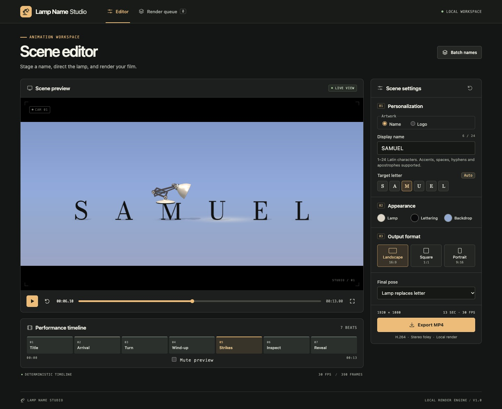
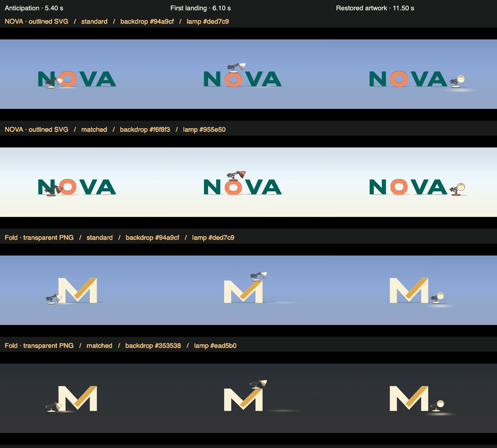
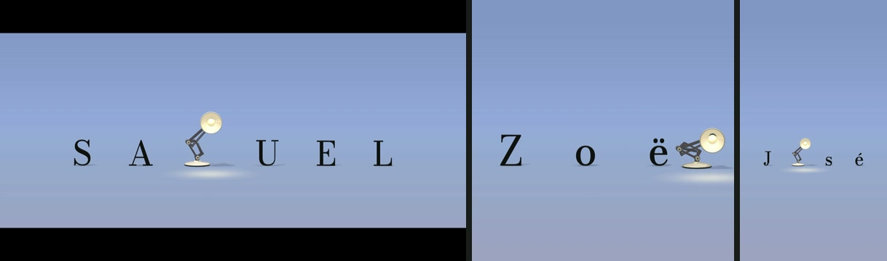
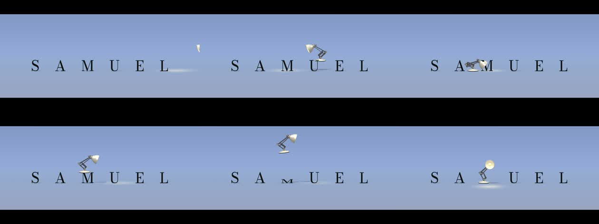
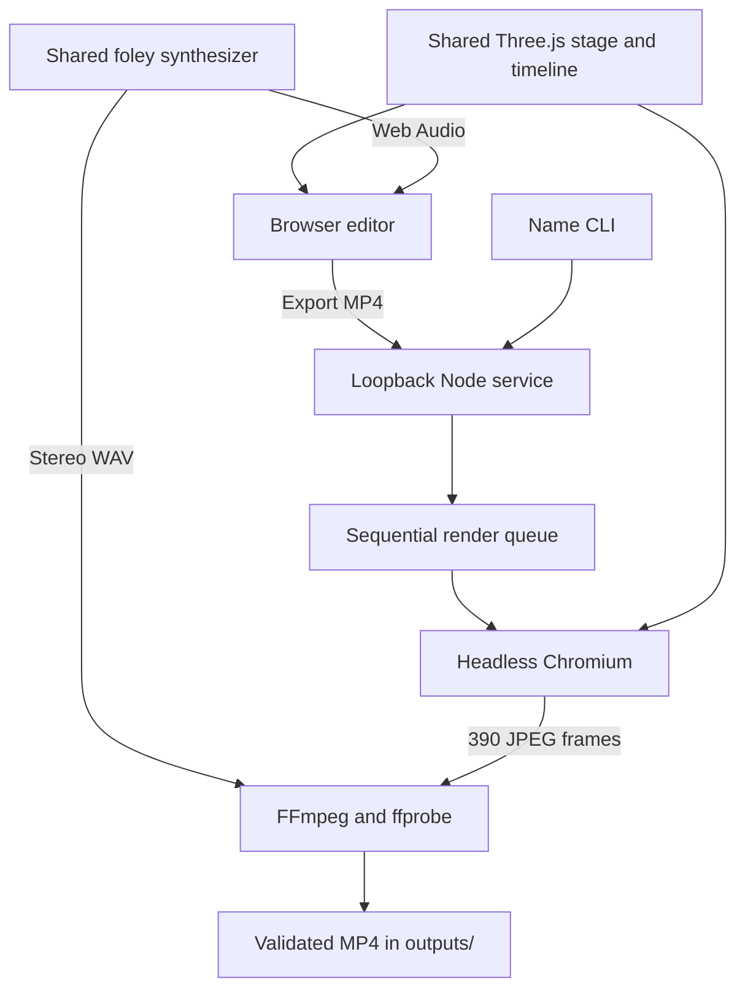

# LAMP · Lamp Name Studio

Make a **13-second 3D title film** from a name or logo. A spring-arm desk lamp hops into frame, winds up, and squashes a letter or part of the artwork. Preview the performance in your browser and export an MP4 with synchronized stereo foley. The studio renders locally.

[Quick start](#quick-start) · [Make a film](#make-a-film) · [Sample films](#sample-films) · [Render pipeline](#render-pipeline)



[Watch the name film · SAMUEL](samples/landscape.mp4) · [Watch the logo film · NOVA](samples/logos/nova-matched.mp4)

## Quick start

Use **Node.js 22.16+**, npm, and a browser with WebGL 2. MP4 export also requires `ffmpeg` and `ffprobe` on your PATH, with the `libx264` and AAC encoders available. [FFmpeg downloads](https://ffmpeg.org/download.html)

```sh
git clone https://github.com/samikd35/LAMP.git
cd LAMP
npm ci
npx playwright install chromium
npm start
```

Open **<http://127.0.0.1:4173>**. `npm start` type-checks and builds both browser pages before starting the loopback server. Keep the server running until exports finish. You can close the editor tab while a job renders. Set `PORT` to use a different port.

## Make a film

### Start with a name

1. Under **Artwork**, select **Name** and enter your title. The default scene is **SAMUEL**, with **M** selected.
2. Pick a **Target letter**, or leave **Auto** selected. Auto favors the `I` or `i` nearest the center when present, then falls back to the closest letter to the center. Repeated letters can be targeted by position.
3. Choose **Lamp replaces letter** to end with the lamp in the title, or **Restore full name** to have it hop down and reveal the complete name.

Names support **1–24 grapheme clusters** with at least one Latin letter from the bundled Bodoni Moda outlines. Common accents, internal spaces, hyphens, and straight or curly apostrophes are supported. The studio preserves case and internal spacing, trims surrounding whitespace, and normalizes equivalent forms such as `José` entered with a combining accent.

### Start with a logo

1. Select **Logo** and upload an outlined SVG or transparent PNG up to **2 MB**. Give SVGs a `viewBox` and convert text and strokes to solid filled shapes. PNGs can be up to **4096 × 4096**.
2. Click a visible part of the logo in the preview or choose it from **Landing part**. Parts are ordered left to right. A connected monogram is one part, while detached shapes such as a dot and stem are separate targets.
3. Try **Match colors to logo** to suggest a lamp paint and backdrop from the artwork's main colors. The logo keeps its own face colors, and the two swatches stay editable.

Logo mode samples the artwork at up to 512 pixels on its longest side and extrudes its alpha contours, including holes. Use prominent shapes for details that need to survive the trace. The lamp dismounts to **Restore full logo** at the end. Switching between modes preserves each draft during the session.



| Logo | Try this artwork | Default colors | Matched colors |
| --- | --- | --- | --- |
| NOVA | [Outlined SVG](examples/logos/NOVA.svg) | [MP4](samples/logos/nova-standard.mp4) | [MP4](samples/logos/nova-matched.mp4) |
| Fold | [Transparent PNG](examples/logos/Fold.png) | [MP4](samples/logos/fold-standard.mp4) | [MP4](samples/logos/fold-matched.mp4) |

### Preview and export

Press **Play**, drag the scrubber, or click one of the seven timeline beats. The editor opens on a paused staging pose, and the first Play starts at the opening fade. **Mute preview** only affects monitoring. Choose a format and set the scene colors, then select **Export MP4** and download the finished film from the **Render queue**.

## Sample films



| Format | Dimensions | Film | Ending | Frame sheet |
| --- | --- | --- | --- | --- |
| Landscape · 16:9 | 1920 × 1080 | [SAMUEL](samples/landscape.mp4) | Lamp replaces M | [Six poses](samples/landscape-poses.jpg) |
| Square · 1:1 | 1080 × 1080 | [Zoë](samples/square.mp4) | Full name restored | [Six poses](samples/square-poses.jpg) |
| Portrait · 9:16 | 1080 × 1920 | [José](samples/portrait.mp4) | Lamp replaces o | [Six poses](samples/portrait-poses.jpg) |

Each MP4 contains **390 frames at 30 fps**, encoded as **H.264** with **48 kHz stereo AAC**. [Name sample settings](samples/manifest.json) · [Logo palette measurements](samples/logos/results.json) · [Layout stress tests](samples/layout-checks.jpg)

### The performance



Read left to right, top to bottom. The lamp crosses the title from the right, stops just past its mark, and turns back for five strikes. Each strike compresses the selected letter or logo part a little further. The final leap has the largest arc and the heaviest sound. The shade swivels independently of the base, carrying the light pool across the stage.

## Batch and CLI

Use **Batch names** to submit up to **250 names**, one per line. Valid rows join the queue with the Name draft's format, colors, and ending. Each name gets its own automatic target. The form keeps invalid rows and reports their original line numbers. Logo exports are submitted individually from the editor.

Jobs render one at a time. You can cancel a queued or active job, or retry a failed or canceled job with its saved settings. **Collect ZIP** packages completed MP4s and a `manifest.json` with job settings and statuses. For logos, the manifest also includes the prepared artwork pixels.

With the studio running, you can submit names from another terminal.

```sh
npm run export -- SAMUEL
npm run export -- --aspect square --target 2 ILLI
npm run export -- --aspect portrait --ending restore --lamp '#c2bba7' 'José'
npm run export -- --aspect landscape --list examples/names.txt
```

`--target` is a **one-based grapheme position** for a single name, counting spaces and punctuation along the way. The job manifest records a zero-based index. The color flags `--lamp`, `--text`, and `--background` take six-digit hex values. The CLI prints progress and waits for the render. Use the server's `PORT` if you changed it.

## Render pipeline



The editor and render page share an articulated lamp, orthographic camera, and exposure sheet. The pose is evaluated directly from time, so seeking backward reconstructs the same scene. For export, Playwright opens `render.html` in fresh Chromium, warms the shaders, then samples the canvas at `n / 30` seconds for frames `0–389`. The exported picture comes from the canvas, while the monitor controls and camera labels live in the editor.

The worker makes a stereo WAV with the same foley synthesizer used for preview. FFmpeg encodes the frames and audio, then ffprobe validates the finished file before it moves into `outputs/`. Filenames include a UUID so duplicate names get separate films. Queue history lives in memory. The files in `outputs/` remain on disk after a restart.

| Change this | Where it lives |
| --- | --- |
| Hops, turns, compressions, and endings | [`src/timeline.mjs`](src/timeline.mjs) |
| Footfalls, hinges, spring sweeps, and reflections | [`src/foley.mjs`](src/foley.mjs) |
| Lamp rig, stage lighting, and camera framing | [`src/lamp.ts`](src/lamp.ts) · [`src/scene.ts`](src/scene.ts) |
| Glyph layout, logo contours, and input validation | [`src/text.ts`](src/text.ts) · [`src/logo.ts`](src/logo.ts) · [`src/config.mjs`](src/config.mjs) |
| Browser editor and frame capture | [`src/editor.ts`](src/editor.ts) · [`src/render.ts`](src/render.ts) |
| Local service, queue, and encoder | [`server/studio.mjs`](server/studio.mjs) · [`server/queue.mjs`](server/queue.mjs) · [`server/worker.mjs`](server/worker.mjs) |

## Verify the studio

```sh
npm test
npm run build
node scripts/verify-logos.mjs
```

The unit tests cover name validation, target selection, pose evaluation, foley timing, and queue behavior. The logo check starts a local service on port 4181, tests SVG and PNG import, verifies click targeting and Name draft restoration, then regenerates the four logo films and comparison sheet. Set `LOGO_TEST_PORT` to use another port.

Run the name integration check with an idle studio running in a separate terminal.

```sh
npm run verify
node scripts/inspect.mjs
```

These checks regenerate the three name samples and their pose sheets, compare a decoded impact frame and audio cue with the preview, test batch and retry behavior, and play a completed film at 1× in Chromium.

### Troubleshooting

- **Preview unavailable.** Enable graphics acceleration and use a browser with WebGL 2.
- **Chromium fails to launch.** Run `npx playwright install chromium` or set `CHROMIUM_PATH` to a compatible Chromium executable. On Linux, install the browser's system dependencies as needed. [Playwright browser setup](https://playwright.dev/docs/browsers)
- **Encoding fails.** Check that `ffmpeg` and `ffprobe` are on the server's PATH, that FFmpeg includes `libx264` and AAC, and that `outputs/` is writable with enough space for a temporary frame sequence.

## Credits and development study

The choreography was developed through a frame-by-frame study of a Pixar lamp ident. The studio builds the rig and scene procedurally and synthesizes its own foley. The analysis and measurements are included, and the downloaded footage and comparison media are optional local study inputs. [Development study](references/STUDY.md) · [Frame measurements](references/frame-study.csv)

The display lettering uses **Bodoni Moda Regular** by the Bodoni Moda Project Authors. Regenerate the bundled outlines with `node scripts/font.mjs`. [SIL Open Font License 1.1](src/assets/OFL.txt)
